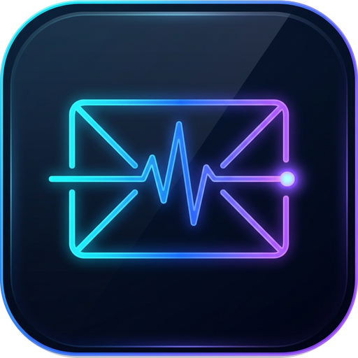
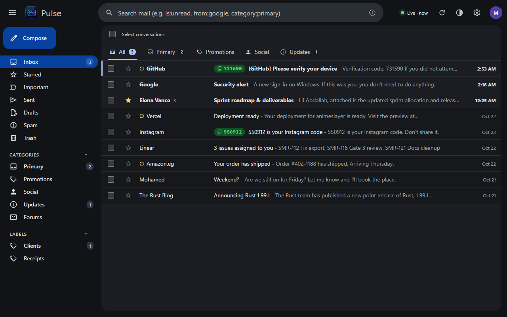

<p align="center">
  
</p>

# Pulse Mail

<p align="center">
  <strong>A lightning-fast, privacy-first desktop Gmail client built with Tauri v2, Rust, and SolidJS.</strong><br>
  Always-on background sync, zero bloat, instant local cache, and native desktop superpowers.
</p>

<p align="center">
  
  
  
  
  <a href="https://github.com/sponsors/abdallahsaber065"></a>
  
</p>

<p align="center">
  
</p>

---

## Overview

Pulse Mail is an independent, high-performance desktop Gmail client designed for speed, privacy, and frictionless daily triage. It lives in your system tray 24/7 with a small memory footprint, delivers new-mail notifications in seconds via IMAP IDLE push, extracts two-factor verification codes right onto notification toasts, and opens any conversation instantly from a local SQLite cache.

Everything runs directly on your machine: sign-in tokens stay in native OS credential managers, email HTML renders in a sandboxed frame, and there is no telemetry and no intermediate server.

---

## Key Features

- ⚡ **Instant Push Sync (IMAP IDLE + Gmail REST API)**: Pulse Mail maintains a persistent IMAP IDLE push connection that acts as a doorbell for incoming mail. When new mail arrives, it wakes a lightweight history sync in milliseconds without battery-draining polling loops.
- 🔑 **Intelligent OTP & 2FA Extraction**: Automatically parses authentication emails to extract one-time verification codes and magic sign-in links. A single click on the notification toast or inbox row chip copies the code directly to your clipboard.
- 📊 **In-App Office & Document Previews (Zero Disk Temp Files)**:
  - **Spreadsheets (`.xlsx`, `.xls`, `.csv`, `.tsv`)**: Interactive SheetJS table with sheet switcher tabs, Excel column coordinates (`A`, `B`, `C`...), row indexes, dimensions badge, and real-time sheet text search.
  - **Word Documents (`.docx`)**: Clean container document rendering via `docx-preview`.
  - **PDF Documents (`.pdf`)**: Native sandboxed viewer with built-in navigation.
  - **Images & Media**: Full zoom/pan image viewer (`.png`, `.jpg`, `.webp`, `.svg`), plus embedded audio and video playback.
  - **Presentations (`.pptx`, `.ppt`)**: Dedicated inspection card with direct system office suite launch.
  - **Pure In-Memory Streaming**: Attachment bytes stream on-demand from SQLite / Gmail REST over Tauri IPC into memory `Blob` and `URL.createObjectURL`
- ⏳ **Undo Send (5–10s Grace Window)**: Hit send without panic. Outgoing emails pause in an in-memory queue with an instant "Undo" button on the UI snackbar before transmitting to Gmail REST.
- 👥 **Local Contact Autocomplete**: Instant fuzzy suggestion dropdown for `To`, `Cc`, and `Bcc` fields based on recipient frequency and address history indexed in local SQLite.
- 🖱️ **Context Menu & Optimistic State Updates**: Full right-click action palette on conversation rows (Mark Read/Unread, Star/Unstar, Mark Important, Spam, Trash, Move Category). All changes update local UI state immediately with zero screen flickering or reader reloads.
- 📐 **Adaptive Resizable Split-View**: Draggable divider between thread list and reader in 2-pane mode (horizontal & vertical layout support), saving preferred widths directly to `localStorage`.
- 💬 **Inline Quick Reply Bar**: Reply or Reply All directly below the last message without opening modal popups.
- ✍️ **Rich Compose Editor (TipTap)**: Formatting toolbar (bold, italic, underline, strike, blockquotes, lists, links), draft auto-saving with debouncing cooldown, attachment staging, and keyboard shortcuts (<kbd>Ctrl</kbd>+<kbd>Enter</kbd>).
- 🗂️ **Multi-Account & Unified Inbox**: Connect multiple Google accounts with instant profile switching, a unified "All Inboxes" aggregate view, and individual account notification controls.
- 🏷️ **Gmail Category Tabs & Labels**: Support for Google's native categories (Primary, Updates, Promotions, Social, Forums) with smooth background reclassification.
- 🔒 **Privacy & Containment by Default**:
  - Refresh tokens secured in OS Credential Vaults (Windows Credential Manager, macOS Keychain, Linux Secret Service).
  - Email HTML rendered exclusively in a sandboxed iframe with strict Content Security Policy (no script execution, no plugins).
  - External links open in your default system browser through strict URL allowlisting (`http`, `https`, `mailto`).
  - Remote tracking pixels and external images suppressed until explicitly authorized.
- 🔍 **Hybrid Search (SQLite FTS5 + Gmail Server)**: Sub-millisecond local search across cached mail using SQLite Full-Text Search (FTS5), with automatic fallback to Gmail server search for older archived correspondence.
- ⌨️ **Keyboard-Driven Workflow**: Full Gmail-standard keyboard navigation (<kbd>j</kbd>/<kbd>k</kbd>, <kbd>e</kbd>, <kbd>#</kbd>, <kbd>s</kbd>, <kbd>r</kbd>, <kbd>a</kbd>, <kbd>f</kbd>) and Command Palette (<kbd>Ctrl</kbd>+<kbd>k</kbd>).
- 🌓 **Native Dark & Light Themes**: Cohesive themes respecting system appearance or manual toggle, with full dark-mode email frame color scheme support.
- 🔄 **Self-Update with Signature Verification**: Pulse Mail checks its own GitHub Releases for new versions (once at launch or on demand), can download them in the background, and asks before installing — both behaviors are configurable in Settings.

---

## Releases

| Platform | Availability | Details |
| :--- | :--- | :--- |
| **Windows** | ✅ **Installer on [Releases](https://github.com/abdallahsaber065/pulse-mail/releases)** (x86_64, Windows 10/11) | NSIS per-user installer; tray integration, native notifications with "Copy code", Credential Manager vault |
| **macOS** | 🧪 **Experimental — Apple Silicon (M-series)** | `.dmg` on Releases, unsigned (right-click → Open on first run). Banner notifications; unread badge in the Dock |
| **Linux** | 🧪 **Experimental — x64 (`.deb` / `.rpm` / `.AppImage`)** | On Releases. Notifications with "Copy code" / "Open" buttons on GNOME/KDE; tray via appindicator |

Notes: notification action buttons and hiding codes on the lock screen are
Windows-only features. Apple Intel (x86_64 Mac) builds are not provided.
Windows remains the most complete and most tested platform. From v0.4.0 on,
installed apps can update themselves from these Releases (signature-checked;
on Linux this covers the AppImage build — `.deb`/`.rpm` update by installing
the new package).

---

## Quick Start & Development

### Prerequisites

- **Node.js** 22+ & **pnpm**
- **Rust** stable (via `rustup`)
- **Platform Compilers**:
  - *Windows*: Visual Studio Build Tools with C++ & WebView2 runtime (preinstalled on Windows 11).
  - *macOS*: Xcode Command Line Tools.
  - *Linux*: `build-essential`, `libwebkit2gtk-4.1-dev`, `libayatana-appindicator3-dev`, `librsvg2-dev`, `libssl-dev`.

### 1. Install Dependencies

```powershell
pnpm install
```

### 2. Run UI in Browser (Mock Mode)

Test and develop the frontend instantly in your browser with simulated mail, attachments, and offline mock data without needing Google credentials:

```powershell
pnpm dev
# Opens at http://localhost:1420
```

### 3. Google OAuth Setup (Developers Compiling From Source Only)

> [!NOTE]
> **Pre-built releases do NOT require this step.** If you download the released installer (`.exe`, `.dmg`, `.deb`), Pulse Mail connects directly using the official, verified Google OAuth client.
>
> If you are compiling from source or self-hosting your own client credentials, set up a Google Cloud desktop client in ~10 minutes:
> 👉 Step-by-step guide: **[docs/SETUP-GOOGLE-OAUTH.md](docs/SETUP-GOOGLE-OAUTH.md)**.

Save your downloaded `google-oauth-client.json` directly into the project root directory:
```
./google-oauth-client.json
```
*(Strictly protected by `.gitignore` so it is never committed to git).*

### 4. Run the Full Desktop App

```powershell
pnpm tauri dev
```

### 5. Build Production Installer

```powershell
pnpm tauri build
```

Output bundles will be generated under `src-tauri/target/release/bundle/`.

---

## Keyboard Shortcuts

Pulse Mail implements Gmail-standard keyboard navigation for power users:

| Shortcut                                       | Action                                  | Scope           |
| :--------------------------------------------- | :-------------------------------------- | :-------------- |
| <kbd>c</kbd>                                   | Compose new email                       | Global          |
| <kbd>/</kbd>                                   | Focus search bar                        | Global          |
| <kbd>Ctrl</kbd> + <kbd>k</kbd>                 | Open Command Palette / Account switcher | Global          |
| <kbd>j</kbd> / <kbd>k</kbd>                    | Move cursor down / up                   | Thread List     |
| <kbd>Enter</kbd> / <kbd>o</kbd>                | Open selected conversation              | Thread List     |
| <kbd>x</kbd>                                   | Toggle checkbox selection               | Thread List     |
| <kbd>e</kbd> or <kbd>y</kbd>                   | Archive conversation                    | Thread / Reader |
| <kbd>#</kbd>                                   | Move conversation to Trash              | Thread / Reader |
| <kbd>s</kbd>                                   | Toggle Star                             | Thread / Reader |
| <kbd>!</kbd>                                   | Report as Spam                          | Thread / Reader |
| <kbd>Shift</kbd> + <kbd>i</kbd> / <kbd>u</kbd> | Mark as Read / Unread                   | Thread / Reader |
| <kbd>Shift</kbd> + <kbd>c</kbd>                | Copy OTP verification code to clipboard | Reader / List   |
| <kbd>r</kbd> / <kbd>a</kbd>                    | Reply / Reply All                       | Reader          |
| <kbd>f</kbd>                                   | Forward message                         | Reader          |
| <kbd>u</kbd> / <kbd>Esc</kbd>                  | Back to conversation list               | Reader          |
| <kbd>Ctrl</kbd> + <kbd>Enter</kbd>             | Send email                              | Compose Modal   |

---

## Architecture & Storage

Pulse Mail follows a strict offline-first architecture where Rust controls all networking, synchronization state, and cryptographic secrets. The webview remains a stateless, high-speed renderer.

```
┌────────────────────────────────────────────────────────┐
│                      Pulse Mail                        │
├──────────────────────────┬─────────────────────────────┤
│   Rust Backend Core      │     SolidJS Webview UI      │
│  - IMAP IDLE Push Engine │  - Virtualized Thread List  │
│  - Gmail REST API V1     │  - TipTap Rich Text Editor  │
│  - SQLite 3 (rusqlite)   │  - Sandboxed Email Frame    │
│  - OS Credential Manager │  - On-Demand Doc Viewer     │
│  - WinRT / Tray Notifier │  - Optimistic State Layer   │
└────────────┬─────────────┴──────────────▲──────────────┘
             │      Tauri v2 IPC (JSON)   │
             └────────────────────────────┘
```

### Storage Locations

| Item | Windows | macOS | Linux |
| :--- | :--- | :--- | :--- |
| **Encrypted Refresh Tokens** | Windows Credential Manager (`com.abdallah.pulsemail`) | macOS Keychain | Secret Service API (gnome-keyring / KWallet) |
| **Local Mail Database** | `%APPDATA%\com.abdallah.pulsemail\pulse-mail.db` | `~/Library/Application Support/com.abdallah.pulsemail/pulse-mail.db` | `~/.config/com.abdallah.pulsemail/pulse-mail.db` |
| **UI Preferences** | Webview `localStorage` | Webview `localStorage` | Webview `localStorage` |

> **Note on Developer Credentials:** When running from source, your optional developer OAuth configuration lives directly in the project root (`./google-oauth-client.json`), strictly ignored by `.gitignore`. Published binary releases use the official embedded client ID and require no client configuration files.

---

## Testing & Quality Gates

Pulse Mail adheres to strict deterministic test gates before any release:

```powershell
# Run frontend unit tests (47 tests across 11 suites)
pnpm test

# Run Rust unit test suite (139 offline unit tests)
cargo test --manifest-path src-tauri/Cargo.toml

# Strict static analysis & linter checks
cargo clippy --manifest-path src-tauri/Cargo.toml --all-targets

# Typecheck and production bundle verification
pnpm build
```

---

## Documentation Index

Detailed architectural specs and design records can be found in `docs/`:

- [CHANGELOG.md](CHANGELOG.md) — Every release, newest first
- [AGENTS.md](AGENTS.md) — Architectural rules, patterns, and conventions for development
- [docs/STATUS.md](docs/STATUS.md) — Real-time progress log, benchmark metrics, and shipped feature status
- [docs/PLAN.md](docs/PLAN.md) — Product phases, acceptance criteria, and performance targets
- [docs/ROADMAP.md](docs/ROADMAP.md) — Prioritized feature catalog and technical specifications
- [docs/ARCHITECTURE.md](docs/ARCHITECTURE.md) — Deep internals of IMAP IDLE, SQLite migrations, and IPC
- [docs/DESIGN.md](docs/DESIGN.md) — Design system tokens, typography, dark mode, and UI guidelines
- [docs/SECURITY.md](docs/SECURITY.md) — Secret isolation, CSP containment, and threat model
- [docs/decisions/](docs/decisions/) — Architecture Decision Records (ADR 0001 – ADR 0025)

---

## Support & Sponsorship

If you find Pulse Mail useful, enjoy using it, or want to support ongoing maintenance and new features, please consider supporting the project:

<p align="left">
  <a href="https://github.com/sponsors/abdallahsaber065">
    
  </a>
</p>

Your sponsorship helps keep Pulse Mail fast, independent, privacy-focused, and actively maintained!

---

## Contributing

Contributions are welcome! Please review [CONTRIBUTING.md](CONTRIBUTING.md) and [AGENTS.md](AGENTS.md) for local environment setup, branching rules, and PR checklists.

---

## License

[MIT](LICENSE) © 2026 Abdallah Saber.

*Personal open-source project; not affiliated with Google. Gmail is a trademark of Google LLC.*
