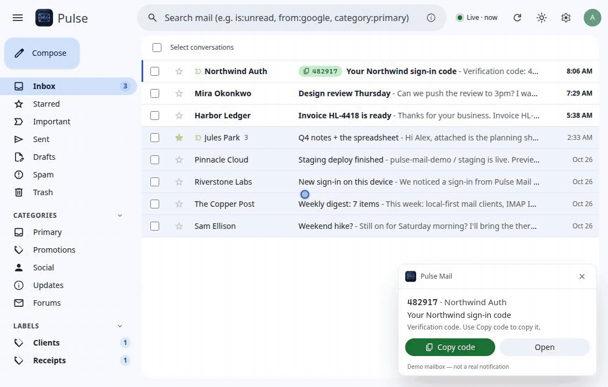

<p align="center">
  
</p>

# Pulse Mail

I wanted a tiny always-on Gmail client that doesn't feel like a browser tab.



Lives in the tray, caches mail in SQLite on your machine, gets push over IMAP IDLE, and puts 2FA codes on the notification so you can copy them without hunting the inbox.

<p>
  
  <a href="https://github.com/abdallahsaber065/pulse-mail/actions/workflows/ci.yml"></a>
  
  
  
</p>

## Download

Installers are on **[GitHub Releases](https://github.com/abdallahsaber065/pulse-mail/releases/latest)** (v0.4.0).

| Platform | File | Notes |
| --- | --- | --- |
| **Windows** 10/11 (x64) | `Pulse.Mail_0.4.0_x64-setup.exe` (per-user) or the `.msi` | Daily-driver build. SmartScreen may warn once — the installer isn't Authenticode-signed yet. "More info" → "Run anyway". |
| **macOS** Apple Silicon | `Pulse.Mail_0.4.0_aarch64.dmg` | **Experimental and unsigned.** After dragging to Applications: right-click → Open the first time. Intel Macs are not built. |
| **Linux** x64 | `.AppImage` (self-updates), `.deb`, or `.rpm` | **Experimental.** Tray needs an appindicator; notification buttons work on GNOME/KDE. |

Windows is the one that's been lived in. macOS and Linux compile and ship; they have not had a long run on real hardware yet ([docs/VERIFY-LIVE.md](docs/VERIFY-LIVE.md)).

After install, drop a Google Cloud **Desktop** OAuth client JSON in the app config dir (one-time, ~10 minutes) and **Sign in with Google**. Google will show an "unverified app" warning — that's expected. Guide: [docs/SETUP-GOOGLE-OAUTH.md](docs/SETUP-GOOGLE-OAUTH.md). See [Privacy & security](#privacy--security).

## What it does

- **Tray + push** — stays running; IMAP IDLE is the doorbell, then a cheap Gmail history sync. Not a 60-second poll loop.
- **OTP on the toast** — verification codes and magic links are pulled out of the mail. Copy from the notification, the row chip, the reader banner, or <kbd>Shift</kbd>+<kbd>C</kbd>.
- **Local cache** — SQLite + FTS5 on disk. Search hits the cache first; Gmail server search fills in older mail.
- **Hostile HTML stays in a box** — sanitized in Rust, rendered in a sandboxed iframe, remote images off until you click. Links open in your system browser (`http`/`https`/`mailto` only).
- **Previews from memory** — PDF, xlsx, docx, images, audio/video. Bytes stream on demand; no extra temp files on disk.
- **Undo send** — 5–10 s grace window before Gmail actually sends.
- **Several accounts** — per-account inboxes plus "All inboxes".

Keyboard shortcuts match Gmail (`j`/`k`, `e`, `s`, `c`, <kbd>Ctrl</kbd>+<kbd>K</kbd> palette). Full list further down.

## Privacy & security

There is **no Pulse Mail server**. The app talks to Google (Gmail OAuth, Gmail REST, IMAP) and, for updates, to this repo's GitHub Releases. No telemetry.

- Refresh tokens live in the OS credential store (Windows Credential Manager, macOS Keychain, Linux Secret Service). Access tokens stay in memory.
- Mail HTML is sanitized (ammonia) and shown in an iframe with `sandbox="allow-scripts"` and **no** `allow-same-origin`, plus a tight frame CSP. Details: [docs/SECURITY.md](docs/SECURITY.md).
- The cache file itself is **not** encrypted at rest (it sits in your user profile). BitLocker / FileVault / LUKS still help.

**Google OAuth is unverified.** The Gmail scope is restricted. Unverified apps are capped at about **100 users**, and Google shows a warning screen on sign-in. Pulse Mail uses **your** Cloud desktop client (the JSON Google lets you download) — there is no Pulse Mail backend and no "official verified" Google app. The installer and source builds both look for `google-oauth-client.json` ([docs/SETUP-GOOGLE-OAUTH.md](docs/SETUP-GOOGLE-OAUTH.md)). Publish that client ("In production") or Google expires refresh tokens after 7 days.

## Run from source

You need Node 22+, pnpm, and stable Rust.

```bash
pnpm install
pnpm tauri dev
```

Put `google-oauth-client.json` in the repo root (gitignored) or in the app config dir. Step-by-step: [docs/SETUP-GOOGLE-OAUTH.md](docs/SETUP-GOOGLE-OAUTH.md).

```bash
pnpm tauri build    # installers under src-tauri/target/release/bundle/
```

Linux extra packages: `libwebkit2gtk-4.1-dev`, `libayatana-appindicator3-dev`, `librsvg2-dev`, `libssl-dev`. Windows: MSVC + WebView2. macOS: Xcode CLT.

## Demo mailbox (no Google account)

The UI runs in a browser against fictional mail — invented companies, `.example` domains, one Northwind OTP thread:

```bash
pnpm dev
# http://localhost:1420
# http://localhost:1420/?toast=1   stand-in OTP notification
```

`PULSE_MAIL_DEMO=1 pnpm tauri dev` uses the same mailbox in a native **dev** window. Release builds ignore that flag. More: [docs/DEMO.md](docs/DEMO.md).

## Keyboard shortcuts

| Shortcut | Action |
| --- | --- |
| <kbd>c</kbd> | Compose |
| <kbd>/</kbd> | Search |
| <kbd>Ctrl</kbd>+<kbd>K</kbd> | Command palette |
| <kbd>j</kbd> / <kbd>k</kbd> | Next / previous |
| <kbd>Enter</kbd> / <kbd>o</kbd> | Open |
| <kbd>e</kbd> | Archive |
| <kbd>s</kbd> | Star |
| <kbd>r</kbd> / <kbd>a</kbd> / <kbd>f</kbd> | Reply / reply all / forward |
| <kbd>Shift</kbd>+<kbd>C</kbd> | Copy verification code |
| <kbd>Ctrl</kbd>+<kbd>Enter</kbd> | Send |
| <kbd>?</kbd> | All shortcuts |

## Docs

- [CHANGELOG.md](CHANGELOG.md) — releases
- [docs/SECURITY.md](docs/SECURITY.md) — threat model
- [docs/STATUS.md](docs/STATUS.md) — what actually works today
- [docs/ARCHITECTURE.md](docs/ARCHITECTURE.md) — sync, SQLite, IPC
- [docs/SETUP-GOOGLE-OAUTH.md](docs/SETUP-GOOGLE-OAUTH.md) — your own OAuth client
- [AGENTS.md](AGENTS.md) — rules for anyone hacking on this

## Contributing

[CONTRIBUTING.md](CONTRIBUTING.md) — setup, demo mode, PR gates.

## License

[MIT](LICENSE) © 2026 Abdallah Saber.

Independent project, not affiliated with Google. Gmail is a trademark of Google LLC.
