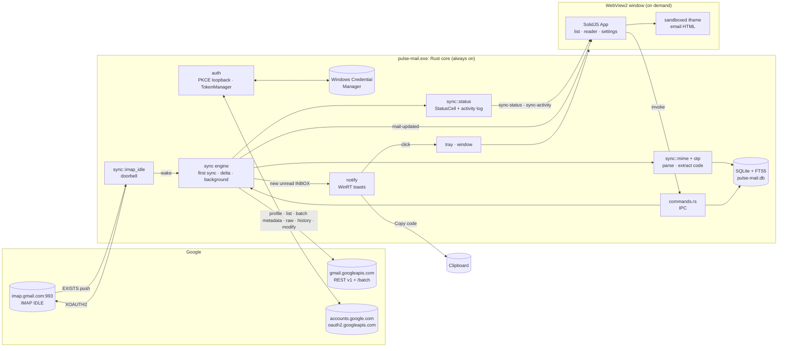
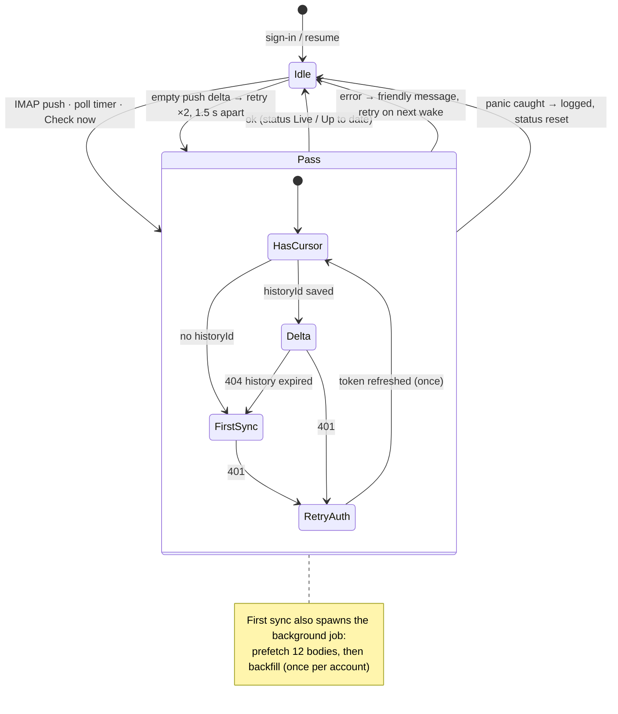
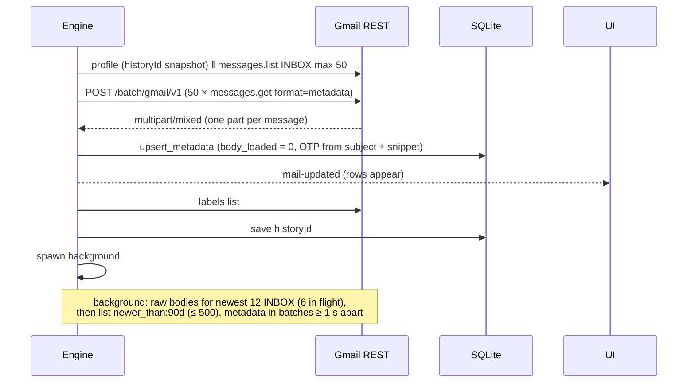
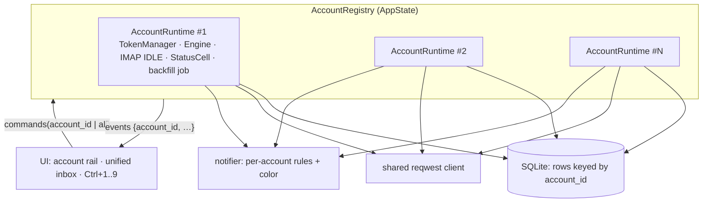

# Architecture

Current as of `HEAD` (v0.1.0). For what works and what doesn't, see
[STATUS.md](STATUS.md); for why, see [decisions/](decisions/).

One Windows process, `pulse-mail.exe`, in two halves:

- **Rust core.** Always running from login. Owns sign-in, tokens, the SQLite
  cache, sync, notifications, tray and window lifecycle. Needs no window.
- **Web UI.** A WebView2 window created on demand. SolidJS renders what the
  core returns over IPC. It keeps only view state (selection, optimistic
  overrides, theme/density in `localStorage`); it never talks to the network.

## Components and data flow

## Module map

| Path | Responsibility |
| --- | --- |
| `src-tauri/src/lib.rs` | `AppState`, plugins (single-instance, autostart, opener, clipboard), tracing, HTTP client, run loop that survives zero windows |
| `commands.rs` | Every IPC command; maps errors to friendly sentences (`friendly!` macro); `start_sync`, `resume` |
| `auth/` | Client file (`client_config.rs`), PKCE + loopback OAuth (`oauth.rs`, `pkce.rs`), keyring (`token_store.rs`), `Secret` (`secret.rs`), access-token cache + refresh (`mod.rs::TokenManager`) |
| `store/` | One SQLite connection, migrations (`migrations.rs`), all queries (`mod.rs`) |
| `sync/mod.rs` | `Engine`: run loop, first sync, background job, delta sync, lazy bodies, label changes, panic isolation |
| `sync/gmail.rs` | Gmail REST client: retry/backoff, error classification, batch endpoint, history folding (`HistoryDelta`) |
| `sync/imap_idle.rs` | IMAP IDLE doorbell (XOAUTH2, rustls) |
| `sync/mime.rs` | Raw MIME → `NewMessage`; metadata → `NewMessage`; `safe_otp` |
| `sync/status.rs` | `StatusCell`: status snapshot, throttled progress, activity ring (60 entries), events |
| `otp/` | Pure OTP extractor |
| `notify/` | WinRT toasts with Copy code / Open |
| `tray.rs`, `window.rs` | Tray menu; show/create/hide/destroy the main window; open a thread from a toast |
| `devtools.rs`, `examples/sync_bench.rs` | Read-only benchmark of the old vs new first sync |
| `src/App.tsx` | UI state: resources, optimistic overrides, actions, shortcuts, events |
| `src/components/` | `TopBar`, `Sidebar`, `ThreadList`, `Reader`, `EmailFrame`, `SyncIndicator`, `AccountMenu`, `SettingsPanel`, `ShortcutsHelp`, `Snackbar`, `ui/dialog`, `ui/Popover`, `SetupCard`, `Avatar`, `Icon` |
| `src/lib/` | `api.ts` (IPC + browser mock in `mock.ts`), `types.ts`, `sync-view.ts` (status chip logic), `format.ts`, `email-frame.ts`, `shortcuts.ts`, `theme.ts`, `prefs.ts` |

## Runtime and threading model

- **Async runtime:** Tauri's Tokio runtime. Long-lived tasks per signed-in
  account: the engine loop and the IMAP IDLE loop (both in
  `SyncController.tasks`). The background job (prefetch + backfill) is a
  separate task guarded by `background_running`, so only one runs at a time.
- **Storage:** one `rusqlite::Connection` behind `Arc<std::sync::Mutex<Store>>`.
  Access goes through short closures (`Engine::db(|s| …)`); a guard is never
  held across `.await`. Locks are poison-tolerant (`unwrap_or_else(into_inner)`).
  WAL mode.
- **IPC commands:** synchronous commands (list, search, get thread, settings)
  are quick SQLite reads. Commands that touch the network are `async`
  (`sign_in`, `sign_out`, `load_thread`, `modify_thread`, `sync_now`).
- **Toasts** are shown from a short-lived `std::thread` because WinRT calls
  can block; their button callbacks run in Rust.
- **Status** lives in `StatusCell` (a `Mutex` + `AppHandle`). Every change
  emits `sync-status`; progress counters are throttled to one event per 120 ms.

## Sync

### State machine (one account)

Poll timer: 15 min while IMAP is live, 60 s while it's down.

### First sync (no saved historyId)

Throttled parts of a batch (429 / 5xx / unparseable) are retried one by one
with backoff (10 in flight). 404 parts are skipped (deleted meanwhile).

### New-mail path (target: toast ≤ 3 s)

1. Gmail delivers to INBOX; the IMAP connection in IDLE gets `EXISTS` and
   calls `wake.notify_one()`.
2. The engine runs `history.list?startHistoryId=<saved>` (all pages) and
   folds records into added / deleted / relabeled (`HistoryDelta`).
3. Deleted rows are removed, relabeled rows get new labels, added ids are
   fetched with `format=raw` (6 in flight, in order), parsed, run through
   `otp::extract` (inside `catch_unwind`), and upserted with `body_loaded = 1`.
4. If the message is new to the cache, in INBOX, UNREAD, under 15 min old,
   and the `notifications` setting allows it (all / otp / off), a toast is shown.
5. `mail-updated` is emitted; the open window reloads from SQLite.

### Lazy bodies and label changes

- `load_thread(thread_id)` downloads `raw` for rows with `body_loaded = 0`,
  then returns the thread. The reader first shows the cached rows (snippet +
  skeleton), then the full bodies.
- `modify_thread(thread_id, add, remove)` changes labels locally first,
  emits `mail-updated`, calls `threads.modify`, and rolls back locally on
  failure. The UI adds its own optimistic overlay and Undo (archive).
  Allowed labels: INBOX, STARRED, UNREAD, IMPORTANT, SPAM, TRASH, `Label_*`.

### Errors and panic isolation

- Gmail errors are classified once (`classify_error`): 401 → `Unauthorized`
  (refresh + retry once), 429 or 403 with a rate-limit reason →
  `RateLimited` (backoff 0.4 / 0.8 / 1.6 s), others → `Status(code)` with
  Google's machine-readable reason logged (never bodies or tokens).
- `SyncError::friendly()` and the `friendly!` macro turn every error into a
  short sentence for the UI; details go to the log.
- A panic must never stop sync: `run_once`, the background job and the IMAP
  loop each run under `catch_unwind`; the status is reset and an activity
  entry is logged. Release builds use `panic = "unwind"` for this
  ([ADR 0007](decisions/0007-panic-isolation.md)).
- All text slicing is char-boundary safe ([ADR 0008](decisions/0008-char-boundary-safe-text.md)).

### IMAP IDLE

INBOX only, as a doorbell ([ADR 0002](decisions/0002-imap-idle-doorbell-rest-history.md)).
Reads the greeting, authenticates with XOAUTH2, `SELECT INBOX`, wakes the
engine once to catch up, then IDLE with a 20 min refresh (`DONE`, `NOOP`,
re-IDLE). On error: backoff 1 s → 60 s; an IMAP `NO` forces a token
refresh; `invalid_grant` waits 15 min.

## Data model (SQLite)

Migrations are append-only (`store/migrations.rs`, tracked by `PRAGMA user_version`).

| Table | Key columns | Notes |
| --- | --- | --- |
| `accounts` | `id`, `email`, `history_id`, `last_sync_at` | One row per signed-in account (only the first is used today) |
| `labels` | `(account_id, id)`, `name`, `kind`, `unread`, `total` | Replaced from `labels.list` |
| `messages` | `(account_id, id)`, `thread_id`, `internal_date`, `from_*`, `to_list`, `subject`, `snippet`, `body_text`, `body_html`, `is_unread`, `is_starred`, `has_attachments`, `otp_code`, `body_loaded` | `body_loaded = 0` rows hold the snippet as `body_text` (migration 2) |
| `message_labels` | `(account_id, label_id, message_id)` | Many-to-many |
| `messages_fts` | FTS5 over subject, sender, snippet, body | External content, kept in sync by triggers; `unicode61 remove_diacritics 2` |
| `settings` | `key`, `value` | `destroy_on_close`, `notifications`, `backfill_done:<account_id>` |

Threads are derived per label with window functions (latest message,
count, any unread, any starred). Search returns one row per message.

## IPC surface

| Command | Purpose |
| --- | --- |
| `get_status` | Client file, account, sync status, settings, data dir, version |
| `sign_in` / `sign_out` | OAuth flow + start sync / stop, revoke, delete token and cache |
| `list_labels`, `list_threads(labelId, limit, offset)`, `search(query, limit)` | Cached reads |
| `get_thread(threadId)` | Cached thread |
| `load_thread(threadId)` | Download missing bodies, then return the thread |
| `modify_thread(threadId, add, remove)` | Archive / star / read / unread |
| `sync_now` | Wake the engine |
| `get_activity` | Activity log (last 60 entries) |
| `set_notifications(mode)`, `set_destroy_on_close(enabled)`, `set_autostart(enabled)` | Settings |
| `take_pending_open`, `copy_text`, `open_external` | Toast → thread hand-off, clipboard, links (http/https/mailto) |

| Event | Payload |
| --- | --- |
| `mail-updated` | none: reload lists/thread from SQLite |
| `sync-status` | `SyncStatus { running, imapConnected, syncing, lastSyncAt, error, progress, backfill }` |
| `sync-activity` | `Activity { at, level, text }` |
| `open-thread` | `OpenTarget { threadId, messageId }` |

The webview capability is `core:default` only; plugins are used from Rust.

## UI architecture

- `App.tsx` owns view state with Solid signals/resources. A `tick` signal
  bumped by `mail-updated` refetches labels, threads and the open thread.
- **Optimistic overlay:** `overrides[threadId] = { unread?, starred?, removed? }`
  is applied on top of fetched rows; dropped after the server call succeeds
  and the next reload arrives, rolled back on failure.
- **Reader loading:** cached rows first, then `load_thread` if any body is missing.
- **Services without a store library:** `confirmDialog()` / `showDialog()`
  (promise-based, `ui/dialog.tsx`), `snack()` queue (`Snackbar.tsx`). Hosts are
  mounted once in `App`.
- **Status chip logic** is a pure function (`lib/sync-view.ts::chipView`) with tests.
- **Demo mailbox:** outside Tauri, `api.ts` routes to `mock.ts` so the UI runs
  with `pnpm dev`. A Tauri *dev* build can opt in with `PULSE_MAIL_DEMO=1`
  (`import.meta.env.DEV` is also required). See [DEMO.md](DEMO.md).

## Process and window lifecycle

- Autostart launches with `--minimized`: tray only, no WebView2.
- `tauri-plugin-single-instance` focuses the existing window on a second launch.
- Closing the window hides it (default) or destroys it (`destroy_on_close`).
  `RunEvent::ExitRequested` without an exit code is prevented, so the
  process lives with zero windows. Tray → Quit calls `exit(0)`.
- A toast click stores a pending `OpenTarget`, shows or creates the window and
  emits `open-thread`; a fresh window pulls it with `take_pending_open`.

## Multi-account target architecture

What changes to run N accounts at once ([ADR 0012](decisions/0012-multi-account.md), proposed):

1. **State:** replace `AppState.sync: Mutex<Option<SyncController>>` and the
   single `status` with `accounts: RwLock<HashMap<i64, AccountRuntime>>`.
   `AccountRuntime` = `SyncController` + its own `StatusCell`. `resume` starts
   one runtime per row in `accounts` with a token in the keyring.
2. **Store:** already keyed by `account_id`. Remove `primary_account()`
   call sites; add `list_accounts()`, account `color`, `display_name`,
   `position`; settings get an optional account scope
   (`notifications:<account_id>`). Unified inbox = the thread query without
   the account filter (window functions partition by `(account_id, thread_id)`).
3. **Commands:** every mail command takes `accountId`; `list_threads`
   accepts `accountId = null` for unified views. `get_status` returns a list
   of account statuses. `sign_in` adds an account instead of replacing;
   `sign_out(accountId)` removes one.
4. **Events:** `sync-status`, `sync-activity`, `mail-updated` gain
   `accountId`. The UI keeps a map of statuses; the chip shows the selected
   account, the popover lists all.
5. **Notifications:** `NewMailToast` gains the account email/color; toast
   activation carries `accountId` so a click switches accounts.
6. **Budgets:** one IMAP socket per account; at most one backfill job
   running across all accounts (a shared semaphore); live deltas run in parallel.
7. **UI:** account rail + Ctrl+1…9; per-account view state (label,
   selection, scroll) kept in memory so switching is instant.

Migration path: introduce the registry with one account first (no
behavior change), then lift the single-account assumptions command by command.

## Why these pieces

See [decisions/](decisions/README.md). Short version: Tauri + WebView2 for
real HTML email with an optional window (0001); IMAP IDLE as a doorbell with
REST history for data (0002); rustls + ring (0003); hide-on-close default
pending measurement (0004); WinRT toasts from Rust (0005); metadata-first
batched first sync (0006); panic isolation (0007); char-boundary-safe text
(0008); in-app dialogs and snackbars (0009); Common-Controls manifest for
every target (0010); local-first label changes (0011).
