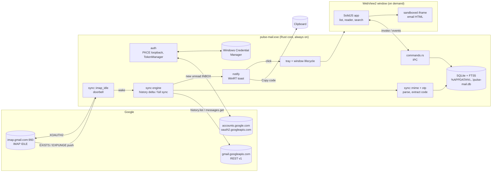

# Architecture

One Windows process (`pulse-mail.exe`) with two halves:

- **Rust core**: always running from login, about 10-25 MB. Owns sign-in,
  tokens, the SQLite cache, sync and notifications. No window needed.
- **Web UI**: a WebView2 window created on demand. It only renders what the
  core gives it over IPC and holds no state of its own.

## New-mail path (target: toast in ≤ 3 s)

1. Gmail delivers a message to INBOX.
2. The IMAP connection, sitting in `IDLE` on INBOX, receives an untagged
   `EXISTS` within about a second. `imap_idle` calls `wake.notify_one()`.
3. The engine wakes and calls `users.history.list?startHistoryId=<saved>`.
   The response is a small JSON diff.
4. `HistoryDelta::from_records` folds it into added / deleted / relabeled ids.
5. Each added id is fetched with `messages.get?format=raw`, parsed with
   `mail-parser`, run through `otp::extract`, and upserted into SQLite.
6. If it's new, unread, in INBOX, and less than 15 min old, a toast is shown.
   OTP mail gets `Copy code` and `Open` buttons.
7. `mail-updated` is emitted; an open window refetches from SQLite.

Gmail's history can trail the IMAP push slightly, so when a push produces
an empty delta the engine retries twice, 1.5 s apart.

## Sync states

| Situation | Behavior |
| --- | --- |
| No saved historyId (first run, after sign-in) | Full sync: profile historyId snapshot → labels → newest 300 messages from the last 60 days → save historyId. No toasts. |
| Saved historyId | Delta via `history.list` (all pages) |
| `history.list` 404 (historyId too old, about a week offline) | Clear historyId, full sync |
| 401 | Drop cached access token, refresh, retry once |
| `invalid_grant` on refresh | Show "Please sign in again"; IMAP backs off 15 min |
| IMAP connected | Safety poll every 15 min |
| IMAP down | Reconnect with backoff 1 s → 60 s; poll every 60 s meanwhile |
| IMAP idle 20 min | `DONE`, `NOOP`, re-`IDLE` (RFC 2177 says under 29 min) |

## Process and window lifecycle

- Starts at login through `tauri-plugin-autostart` with `--minimized`: tray
  only, no window, no WebView2.
- A second launch is caught by `tauri-plugin-single-instance` and focuses the
  existing window.
- Closing the window either **hides** it (default, instant reopen; WebView2
  stays resident) or **destroys** it (smallest idle RAM; reopening recreates
  it from config). `RunEvent::ExitRequested` without an exit code is
  prevented, so the process survives with zero windows. Tray → Quit exits.
- A toast click calls `window::open_thread`, which stores a pending target,
  shows or creates the window, and emits `open-thread`. A freshly created
  window pulls the target with `take_pending_open` on mount.

## Data model (SQLite)

`accounts(id, email, history_id, last_sync_at)` ·
`labels(account_id, id, name, kind, unread, total)` ·
`messages(account_id, id, thread_id, internal_date, from_*, to_list, subject, snippet, body_text, body_html, is_unread, is_starred, has_attachments, otp_code)` ·
`message_labels(account_id, label_id, message_id)` ·
`messages_fts` (FTS5, external content, kept in sync by triggers) ·
`settings(key, value)`.

Threads are derived with a window function (latest message per thread
within a label). WAL mode and a 2 MB page cache keep it fast and small.

## IPC surface (`commands.rs`)

`get_status`, `sign_in`, `sign_out`, `list_labels`, `list_threads`,
`search`, `get_thread`, `sync_now`, `take_pending_open`, `copy_text`,
`open_external`, `set_destroy_on_close`, `set_autostart`.
Events: `mail-updated`, `sync-status`, `open-thread`.

The webview's capability is `core:default` only. Plugins (opener,
clipboard, autostart) are used from Rust, never exposed to JS.

## Why these pieces

See `docs/decisions/`. Short version:

- **Tauri + WebView2** instead of egui/iced/Slint: real HTML email rendering
  for free; the UI process can be destroyed when not needed (ADR 0001).
- **IMAP IDLE as doorbell + REST history for data**: push without a public
  server; JSON diffs instead of MIME/IMAP threading logic (ADR 0002).
- **rustls with ring** everywhere: one TLS stack, no cmake/nasm build deps (ADR 0003).
- **Own WinRT toast** (`tauri-winrt-notification`) instead of the
  notification plugin: button callbacks run in Rust even with no window (ADR 0005).
