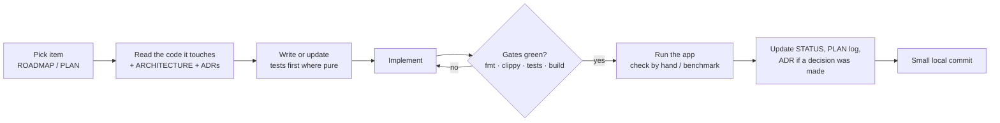

# How we work

How Pulse Mail is built, for humans and AI agents alike. The hard rules are
in [AGENTS.md](../AGENTS.md); this file is the process around them.

## Principles

1. **Docs first, then code.** A feature starts as an entry in
   [ROADMAP.md](ROADMAP.md), moves into a phase in [PLAN.md](PLAN.md) with
   acceptance criteria, gets an ADR if it makes a lasting choice, and only
   then gets built. After it ships, [STATUS.md](STATUS.md) says what really
   works, honestly.
2. **Measure, don't guess.** Speed claims come with numbers from the user's
   PC (benchmark, log line or Task Manager), written into PLAN.md.
3. **Small, safe steps.** Small local commits; never lose the user's data
   or sign-in; never break the always-on app for long.
4. **The user sees friendly text; the log gets details; secrets go nowhere.**

## The loop for a change



## Gates (run before every commit)

```powershell
cargo fmt --manifest-path src-tauri/Cargo.toml
cargo clippy --manifest-path src-tauri/Cargo.toml --all-targets   # must be warning-free
cargo test --manifest-path src-tauri/Cargo.toml                   # offline, deterministic
pnpm test                                                         # vitest
pnpm build                                                        # tsc --noEmit + vite build
```

Run targeted tests while iterating (`cargo test … otp::`, `pnpm vitest run
src/lib/sync-view.test.ts`) and everything before calling a phase done.
Never merge or mark done on red. There's no CI yet; the gates are local.

## Running the app in development

- Full app: `pnpm tauri dev` from the repo root. On the user's PC it runs
  in a visible console titled **Pulse Mail (dev)**, with output also written
  to `%TEMP%\pulse-mail-dev.log`:

  ```powershell
  Start-Process powershell -WorkingDirectory "<repo>" -ArgumentList '-NoExit','-Command',
    "`$Host.UI.RawUI.WindowTitle = 'Pulse Mail (dev)'; pnpm tauri dev 2>&1 | Tee-Object -FilePath `$env:TEMP\pulse-mail-dev.log"
  ```

- Editing `src-tauri/` while it runs triggers a rebuild and restart of the
  app; editing `src/` hot-reloads the UI. Don't restart or stop the user's
  running app unless the task needs it, and say so when you do.
- UI only, with mock data in a browser: `pnpm dev` (http://localhost:1420).
  Handy for layout work and headless screenshots; hover styles need a real
  mouse (Tailwind v4 wraps `hover:` in `@media (hover: hover)`).
- Log level: `PULSE_MAIL_LOG=debug` (default `pulse_mail_lib=info,warn`).
  Useful lines: `first page ready count=… ms=…`, `backfill done`, `imap idle
  connected`, `sync failed`, `sync pass panicked`.
- On the user's PC `CARGO_TARGET_DIR` is `D:\t` (short path, outside the repo).

## Benchmarks

`cargo run --example sync_bench` (in `src-tauri`) times the old and new first
sync against the signed-in account: read-only Gmail calls, prints only
counts and timings. It reads the client file, the account from the DB
(read-only) and the refresh token from Credential Manager, so run it only
when the user has agreed to calls against their account. Record results in
PLAN.md's progress log.

## Secrets and the user's data

- Never commit, print or log tokens, client secrets, message bodies or
  subjects. `Secret` hides tokens in `Debug`/`Display`.
- Don't sign the user out, delete `pulse-mail.db`, or clear Credential
  Manager entries unless asked. Schema changes are new migrations, never
  edits to shipped ones; existing rows must keep working.
- Don't run anything that calls Google with the user's credentials unless
  the task asks for it. Tests use fixtures and in-memory SQLite.

## Commits

- Local repo only: no remote, never push. Don't rewrite history, stash,
  reset or delete branches.
- Small, focused commits with imperative subjects and a short body listing
  what changed (see `git log`). Docs updates can be their own commit.

## Decisions

Write an ADR in `docs/decisions/` when a choice is hard to reverse or
someone will later ask "why?". Proposed ADRs are fine for designs that
aren't built yet. Never rewrite an accepted ADR: add an "Updates" note or a
superseding ADR.

## Working as an AI agent in this repo

- Start with AGENTS.md, then the docs for the area you touch. Read the
  actual code before claiming anything in docs: STATUS.md must describe
  `HEAD`, not plans.
- Prefer the smallest change that meets the acceptance criteria; don't add
  dependencies, network endpoints, scopes or telemetry without asking.
- Keep user-facing text friendly and short; no technical errors in the UI.
- Report at the end: what changed (files), how it was verified (commands,
  numbers), what's still missing, and any decision the user should make.
- If the user's app is running, leave it running with the new build when
  you're done, or tell them exactly how to start it.
